<div align="center">


**A vibe-coded world simulator for recreating and exploring physics-based animation.**


[ThunderGS](#thundergs) · [StormGS](#stormgs) · [LavaGS](#lavags) · [SnowyGS](#snowygs) · [RainyGS](#rainygs)<br>
[DiffWind](#diffwind) · [Plant Wilting](#plant-wilting) · [PhysSkin](#physskin) · [MeGAS](#megas)<br>
[Gaussian Splashing](#gaussian-splashing) · [Water + Sand](#water-sand) · [EnliveningGS](#enliveninggs) · [Magnetic MPM](#magnetic-mpm)<br>
[Capillary Contact](#capillary-contact) · [Ice Melting](#ice-melting) · [Fire-X GS](#fire-x-gs) · [Multi-fluid](#multi-fluid)<br>
[Ice Solidification](#ice-solidification) · [Tree & Root Growth](#rhizomorph) · [Windy Trees](#windy-trees)<br>
[Magnetic Rigid Bodies](#magnetic-rigid-bodies) · [Thin-Film Bubbles](#thin-film-bubbles)

[**Get started**](INSTALL.md) &nbsp; / &nbsp; [**Download assets**](ASSETS.md) &nbsp; / &nbsp; [**Video gallery**](media/index.html)

</div>

---

A growing collection of physics-based animation projects, from solvers to
rendered demos. Explore the code and run guides, or click an animated preview
to watch the full video.

<a id="thundergs"></a>

##  ThunderGS

[Thunderstruck: Visually Simulating Electrical Storms](https://jonathank.de/research/paper/Herrera2025_thunderstruck.pdf) brings electric-field-driven lightning branches, ground attachment, and flash illumination to Gaussian scenes.

<table>
  <tr>
    <td align="center" valign="top" width="33%"><a href="media/thunder_gs/firewoods.mp4">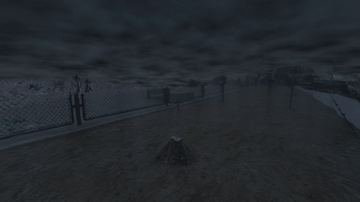</a><br><b>Firewoods</b></td>
    <td align="center" valign="top" width="33%"><a href="media/thunder_gs/zohar.mp4">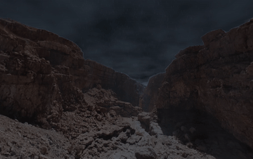</a><br><b>Zohar</b></td>
    <td align="center" valign="top" width="33%"><a href="media/thunder_gs/train.mp4">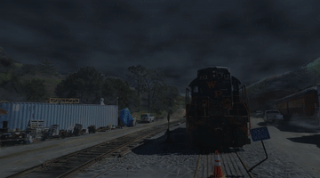</a><br><b>Train</b></td>
  </tr>
</table>

[**Code & run guide →**](thunder_gs/README.md)

<a id="stormgs"></a>

##  StormGS

[Cyclogenesis: Simulating Hurricanes and Tornadoes](https://computationalsciences.org/publications/amador-herrera-2024-cyclogenesis.html) brings rotating clouds, rain, sea spray, and terrain-driven dust to Gaussian scenes.

<table>
  <tr>
    <td align="center" valign="top" width="33%"><a href="media/storm_gs/playground.mp4">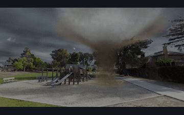</a><br><b>Playground</b></td>
    <td align="center" valign="top" width="33%"><a href="media/storm_gs/lands_end.mp4">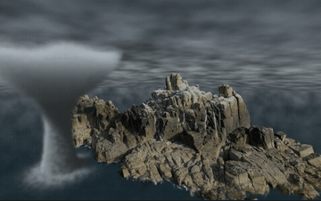</a><br><b>Land's End</b></td>
    <td align="center" valign="top" width="33%"><a href="media/storm_gs/calico.mp4">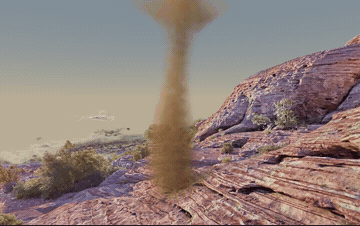</a><br><b>Calico</b></td>
  </tr>
</table>

[**Code & run guide →**](storm_gs/README.md)

<a id="lavags"></a>

##  LavaGS

LavaGS combines [Augmented MPM for Phase-Change and Varied Materials](https://www.cs.ucr.edu/~craigs/papers/2014-melting/paper.pdf) with Gaussian scenes for lava flow, crust formation, rock contact, and thermal emission.

<table>
  <tr>
    <td align="center" valign="top" width="33%"><a href="media/lava_gs/zohar.mp4">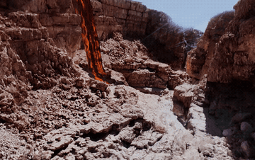</a><br><b>Zohar canyon</b></td>
    <td align="center" valign="top" width="33%"><a href="media/lava_gs/lands_end.mp4">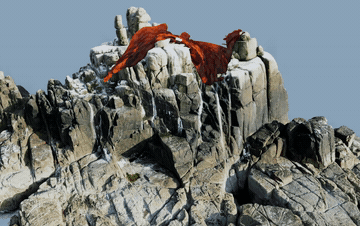</a><br><b>Land's End cliff</b></td>
    <td align="center" valign="top" width="33%"><a href="media/lava_gs/calico.mp4">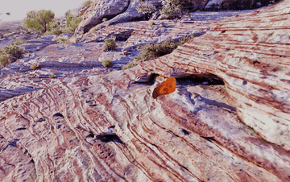</a><br><b>Calico</b></td>
  </tr>
</table>

[**Code & run guide →**](lava_gs/README.md)

<a id="snowygs"></a>

##  SnowyGS

SnowyGS combines [A Material Point Method for Snow Simulation](https://alexey.stomakhin.com/research/snow.html) with Gaussian scenes for wind-driven snowfall and accumulated snow.

<table>
  <tr>
    <td align="center" width="33%"><a href="media/snowy_gs/playground.mp4">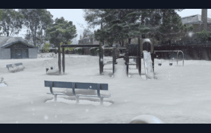</a><br><b>Playground</b></td>
    <td align="center" width="33%"><a href="media/snowy_gs/firewoods.mp4">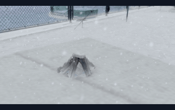</a><br><b>Firewoods</b></td>
    <td align="center" width="33%"><a href="media/snowy_gs/train.mp4">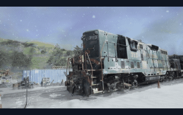</a><br><b>Train</b></td>
  </tr>
</table>

[**Code & run guide →**](snowy_gs/README.md)

<a id="rainygs"></a>

##  RainyGS

[RainyGS](https://pku-vcl-geometry.github.io/RainyGS/) synthesizes rain, splashes, and water effects in Gaussian scenes.

<table>
  <tr>
    <td align="center" width="33%"><a href="media/rainy_gs/playground.mp4">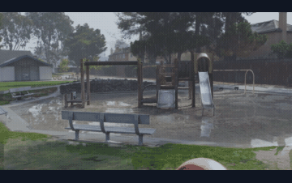</a><br><b>Playground</b></td>
    <td align="center" width="33%"><a href="media/rainy_gs/firewoods.mp4">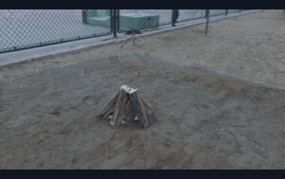</a><br><b>Firewoods</b></td>
    <td align="center" width="33%"><a href="media/rainy_gs/train.mp4">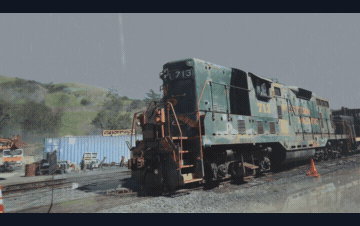</a><br><b>Train</b></td>
  </tr>
</table>

[**Code & run guide →**](rainy_gs/README.md)

<a id="diffwind"></a>

##  DiffWind

[DiffWind](https://github.com/zju3dv/DiffWind) models wind-driven Gaussian object dynamics through differentiable fluid-solid coupling with LBM and MPM.

<table>
  <tr>
    <td align="center" valign="top" width="33%"><a href="https://github.com/zju3dv/DiffWind/blob/main/media/results/potted_plant_view0.mp4"></a><br><b>Potted Plant</b></td>
    <td align="center" valign="top" width="33%"><a href="https://github.com/zju3dv/DiffWind/blob/main/media/results/sweater_view0.mp4"></a><br><b>Sweater</b></td>
    <td align="center" valign="top" width="33%"><a href="https://github.com/zju3dv/DiffWind/blob/main/media/results/flag_view0.mp4"></a><br><b>Flag</b></td>
  </tr>
</table>

[**Code & run guide →**](https://github.com/zju3dv/DiffWind)

<a id="plant-wilting"></a>

##  Plant Wilting

[A Physically-inspired Approach to the Simulation of Plant Wilting](https://dl.acm.org/doi/10.1145/3610548.3618218) couples water transport and material softening to animate drying plants, rendered here with 3D Gaussians.

<table>
  <tr>
    <td align="center" valign="top" width="33%"><a href="media/plant_wilting/potted_plant.mp4">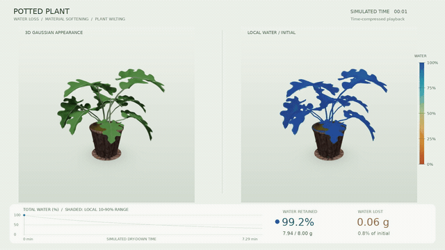</a><br><b>Potted Plant</b></td>
    <td align="center" valign="top" width="33%"><a href="media/plant_wilting/ficus.mp4">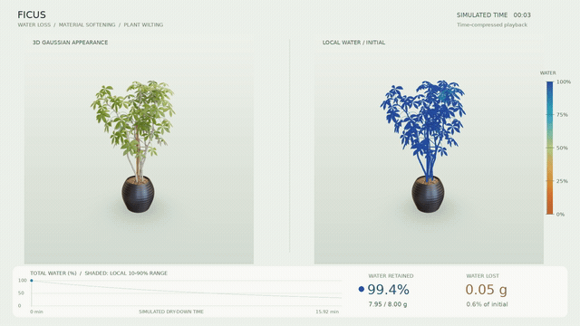</a><br><b>Ficus</b></td>
    <td align="center" valign="top" width="33%"><a href="media/plant_wilting/alocasia.mp4">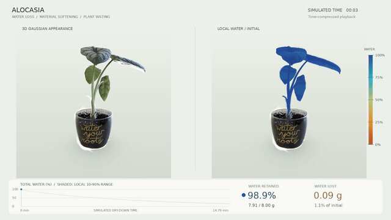</a><br><b>Alocasia</b></td>
  </tr>
</table>

[**Code & run guide →**](plant_wilting/README.md)

<a id="physskin"></a>

##  PhysSkin

[PhysSkin](https://github.com/zju3dv/PhysSkin) learns continuous neural skinning fields for real-time, generalizable physics-based animation across diverse 3D shapes.

<p align="center">
  <a href="https://huggingface.co/papers/2610.26067?image-viewer=B81F15613A4EABA144DFC55E0D95B4EA498EE910">
    
  </a>
  <br>
  <a href="https://huggingface.co/papers/2610.26067?image-viewer=B81F15613A4EABA144DFC55E0D95B4EA498EE910"><b>▶ Watch the PhysSkin++ teaser</b></a>
</p>

[**Code & run guide →**](https://github.com/zju3dv/PhysSkin)

<a id="megas"></a>

##  MeGAS

[MeGAS](https://zju3dv.github.io/MeGAS/) incorporates thermomechanical phase-change dynamics with temperature fields and thermomechanical phase transitions to Gaussian scenes for melting and solidification.


<p align="center">
  <b>Bidirectional Phase-Change Editing</b><br>
  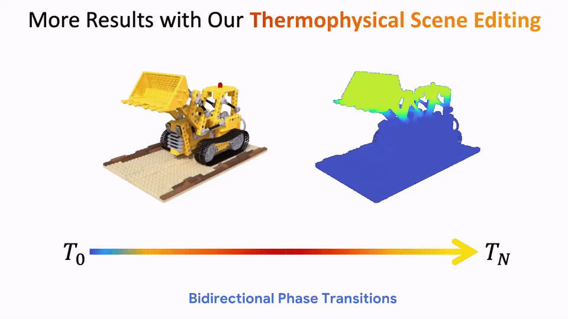
</p>

[**Code & run guide →**](https://github.com/zju3dv/MeGAS)

<a id="gaussian-splashing"></a>

##  Gaussian Splashing

[Gaussian Splashing](https://gaussiansplashing.github.io/) unifies particles for fluid and solid motion synthesis and Gaussian rendering.

<table>
  <tr>
    <td align="center" width="33%"><a href="media/gaussian_splashing/liquify.mp4">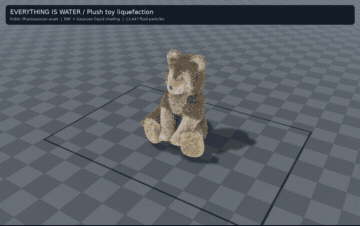</a><br><b>Liquefy</b></td>
    <td align="center" width="33%"><a href="media/gaussian_splashing/wave.mp4">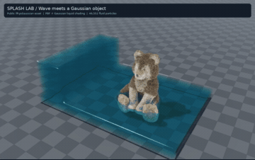</a><br><b>Wave</b></td>
    <td align="center" width="33%"><a href="media/gaussian_splashing/plunge.mp4">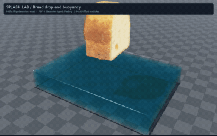</a><br><b>Plunge</b></td>
  </tr>
</table>

[**Code & run guide →**](gaussian_splashing/README.md)

<a id="water-sand"></a>

##  Water + Sand

Water + Sand combines [Volume-Preserving LBM-MPM Coupling for Air-Water-Sand Mixtures](https://lwkobe.github.io/papers/XWYDL2026/) with Gaussian rendering for 3D sandcastle erosion, sedimentation, and dam overtopping.

<table>
  <tr>
    <td align="center" valign="top" width="33%"><a href="media/water_sand/breach.mp4">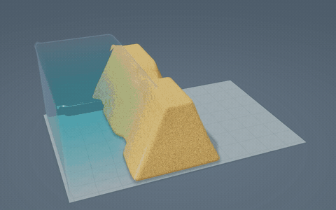</a><br><b>Sand dam</b></td>
    <td align="center" valign="top" width="33%"><a href="media/water_sand/sediment.mp4">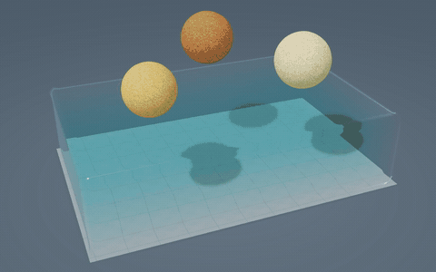</a><br><b>Sedimentation</b></td>
    <td align="center" valign="top" width="33%"><a href="media/water_sand/castle.mp4">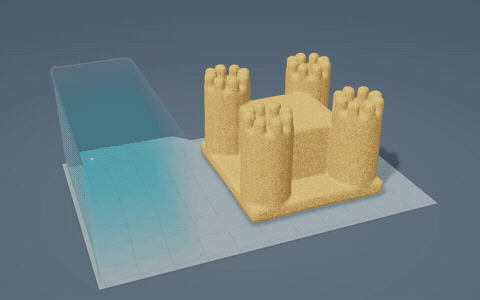</a><br><b>Sandcastle</b></td>
  </tr>
</table>

[**Code & run guide →**](water_sand/README.md)

<a id="enliveninggs"></a>

##  EnliveningGS

[EnliveningGS](https://gapszju.github.io/EnliveningGS/) gives 3D Gaussian objects active locomotion through muscle-driven deformation and contact.

<table>
  <tr>
    <td align="center" width="33%"><a href="media/enlivening_gs/bread.mp4">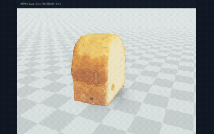</a><br><b>Hopping bread</b></td>
    <td align="center" width="33%"><a href="media/enlivening_gs/wolf.mp4">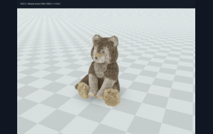</a><br><b>Turning wolf</b></td>
    <td align="center" width="33%"><a href="media/enlivening_gs/vasedeck.mp4">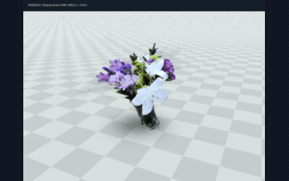</a><br><b>Dancing vase</b></td>
  </tr>
</table>

[**Code & run guide →**](enlivening_gs/README.md)

<a id="magnetic-mpm"></a>

##  Magnetic MPM

[A Material Point Method for Nonlinearly Magnetized Materials](https://binwangbfa.github.io/publication/siga21_mpm/) couples nonlinear magnetic fields with deformable solids and viscous fluids.

<table>
  <tr>
    <td align="center" width="33%"><a href="media/magnetic_mpm/ferrofluid.mp4">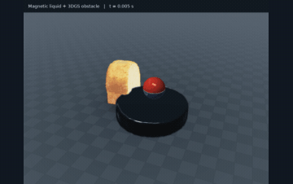</a><br><b>Ferrofluid</b></td>
    <td align="center" width="33%"><a href="media/magnetic_mpm/magnetic_bread.mp4">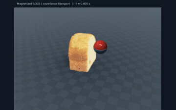</a><br><b>Magnetic bread</b></td>
    <td align="center" width="33%"><a href="media/magnetic_mpm/magnetic_wolf.mp4">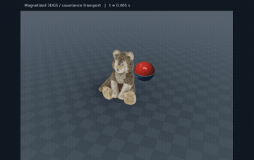</a><br><b>Magnetic wolf</b></td>
  </tr>
</table>

[**Code & run guide →**](magnetic_mpm/README.md)

<a id="capillary-contact"></a>

##  Capillary Contact

[Solid-Fluid Interaction with Surface-Tension-Dominant Contact](https://arxiv.org/abs/2105.08471) couples surface tension and solid contact to support floating objects and produce capillary clustering.

<table>
  <tr>
    <td align="center" valign="top" width="33%"><a href="media/surface_tension/orchard.mp4"></a><br><b>Miniature orchard</b></td>
    <td align="center" valign="top" width="33%"><a href="media/surface_tension/capillary_cluster.mp4"></a><br><b>Capillary cluster</b></td>
    <td align="center" valign="top" width="33%"><a href="media/surface_tension/paperclips.mp4"></a><br><b>Paperclips</b></td>
  </tr>
</table>

[**Code & run guide →**](surface_tension/README.md)

<a id="ice-melting"></a>

##  Ice Melting

[Fast Particle-based Visual Simulation of Ice Melting](https://onlinelibrary.wiley.com/doi/abs/10.1111/j.1467-8659.2010.01810.x) and [Ice Melting Simulation with Water Flow Handling](https://people.cs.nycu.edu.tw/~cswingo/research/papers/Ice%20Melting%20Simulation_Lii_Wong.pdf) explore particle heat transfer, melting ice, and flowing water.

<table>
  <tr>
    <td align="center" valign="top" width="33%"><a href="media/ice_melting/cubes.mp4"></a><br><b>Ice cubes</b></td>
    <td align="center" valign="top" width="33%"><a href="media/ice_melting/arch.mp4"></a><br><b>Thawing arch</b></td>
    <td align="center" valign="top" width="33%"><a href="media/ice_melting/bunny.mp4"></a><br><b>Bunny</b></td>
  </tr>
</table>

[**Code & run guide →**](ice_melting/README.md)

<a id="fire-x-gs"></a>

##  Fire-X GS

[Fire-X: Extinguishing Fire with Stoichiometric Heat Release](https://helgewrede.github.io/firex/) and [FieryGS](https://pku-vcl-geometry.github.io/FieryGS/) bring fire, water-driven cooling, and persistent carbonization to Gaussian scenes.

<table>
  <tr>
    <td align="center" valign="top" width="33%"><a href="media/firex_gs/firewoods.mp4"></a><br><b>Firewoods</b></td>
    <td align="center" valign="top" width="33%"><a href="media/firex_gs/playground.mp4"></a><br><b>Playground</b></td>
    <td align="center" valign="top" width="33%"><a href="media/firex_gs/bonsai.mp4"></a><br><b>Bonsai</b></td>
  </tr>
</table>

[**Code & run guide →**](firex_gs/README.md)

<a id="multi-fluid"></a>

##  Multi-fluid

[An Implicitly Stable Mixture Model for Dynamic Multi-fluid Simulations](https://doi.org/10.1145/3610548.3618215) couples phase motion, diffusion, and incompressibility for tea brewing, density inversion, and colliding liquids.

<table>
  <tr>
    <td align="center" valign="top" width="33%"><a href="media/implicit_mixture/tea_brewing.mp4"></a><br><b>Tea brewing</b></td>
    <td align="center" valign="top" width="33%"><a href="media/implicit_mixture/density_inversion.mp4"></a><br><b>Density inversion</b></td>
    <td align="center" valign="top" width="33%"><a href="media/implicit_mixture/chromatic_collision.mp4"></a><br><b>Chromatic collision</b></td>
  </tr>
</table>

[**Code & run guide →**](implicit_mixture/README.md)

<a id="ice-solidification"></a>

##  Ice Solidification

[Solidification using smoothed particle hydrodynamics](https://doi.org/10.1016/j.jcp.2004.11.039) models heat transfer and latent heat for growing ice and coupled liquid motion.

<table>
  <tr>
    <td align="center" valign="top" width="33%"><a href="media/ice_solidification/ice_cast.mp4"></a><br><b>Frozen star</b></td>
    <td align="center" valign="top" width="33%"><a href="media/ice_solidification/cascade.mp4"></a><br><b>Frozen cascade</b></td>
    <td align="center" valign="top" width="33%"><a href="media/ice_solidification/cold_finger.mp4"></a><br><b>Cryogenic bloom</b></td>
  </tr>
</table>

[**Code & run guide →**](ice_solidification/README.md)

<a id="rhizomorph"></a>

##  Tree & Root Growth

[Rhizomorph: The Coordinated Function of Shoots and Roots](https://storage.googleapis.com/pirk.io/projects/rhizomorph/index.html) couples soil resources and plant signals to grow branching roots and leafy crowns together.

<table>
  <tr>
    <td align="center" valign="top" width="33%"><a href="media/rhizomorph/oak_taproot.mp4"></a><br><b>Oak</b></td>
    <td align="center" valign="top" width="33%"><a href="media/rhizomorph/maple_heart.mp4"></a><br><b>Maple</b></td>
    <td align="center" valign="top" width="33%"><a href="media/rhizomorph/birch_lateral.mp4"></a><br><b>Birch</b></td>
  </tr>
</table>

[**Code & run guide →**](rhizomorph/README.md)

<a id="windy-trees"></a>

##  Windy Trees

[Windy Trees: Computing Stress Response for Developmental Tree Models](https://storage.googleapis.com/pirk.io/projects/windy_trees/index.html) couples turbulent wind and elastic tree motion, with fine air-particle paths revealing the flow around each crown.

<table>
  <tr>
    <td align="center" valign="top" width="33%"><a href="media/windy_trees/oak_taproot.mp4"></a><br><b>Oak</b></td>
    <td align="center" valign="top" width="33%"><a href="media/windy_trees/maple_heart.mp4"></a><br><b>Maple</b></td>
    <td align="center" valign="top" width="33%"><a href="media/windy_trees/birch_lateral.mp4"></a><br><b>Birch</b></td>
  </tr>
</table>

[**Code & run guide →**](windy_trees/README.md)

---

<a id="magnetic-rigid-bodies"></a>
##  Magnetic Rigid Bodies

[Strongly Coupled Simulation of Magnetic Rigid Bodies](https://doi.org/10.1111/cgf.15185) couples magnetic forces, induced magnetization, and rigid contact for compass alignment, electromagnetic transport, and magnetic assembly.

<table><tr>
  <td align="center" valign="top" width="33%"><a href="media/magnetic_rigid/compass_garden.mp4"></a><br><b>Field of Needles</b></td>
  <td align="center" valign="top" width="33%"><a href="media/magnetic_rigid/magnetic_globe.mp4"></a><br><b>Magnetic Cabinet</b></td>
  <td align="center" valign="top" width="33%"><a href="media/magnetic_rigid/magnetic_crane.mp4"></a><br><b>Electromagnetic Foundry</b></td>
</tr></table>

[**Code & run guide →**](magnetic_rigid/README.md)

---

<a id="thin-film-bubbles"></a>

##  Thin-Film Bubbles

[A Moving Eulerian-Lagrangian Particle Method for Thin Film and Foam Simulation](https://yitongdeng.github.io/MELP_Project.github.io/) separates surface geometry from material flow to animate capillary recoil, pressure-driven deformation, and bubble collisions with thin-film iridescence.

<table><tr>
  <td align="center" valign="top" width="33%"><a href="media/melp_thin_film/giant_recoil.mp4"></a><br><b>Giant Bubble Recoil</b></td>
  <td align="center" valign="top" width="33%"><a href="media/melp_thin_film/driven_bubble.mp4"></a><br><b>Breathing Bubble</b></td>
  <td align="center" valign="top" width="33%"><a href="media/melp_thin_film/bubble_collision.mp4"></a><br><b>Bubble Collision</b></td>
</tr></table>

[**Code & run guide →**](melp_thin_film/README.md)

---

## Run a demo

See [installation](INSTALL.md) for the CUDA environment, then:

```bash
python -m physstudio fetch bread
python -m physstudio run enlivening bread --gpu 0
```

Use `--frames 12 --width 640` for a quick preview and `--output` for a custom
run directory. Use `--dry-run` to print the launcher's exact commands.
Pretrained models are downloaded separately; [asset links](ASSETS.md) and
[project credits](THIRD_PARTY.md) are collected in the repository.

<details>
<summary><b>Repository map</b></summary>

```text
thunder_gs/           Electric discharge, grounded terrain, and flash lighting
storm_gs/             Moist vortices, rain, sea spray, and transported dust
lava_gs/              Thermoviscoplastic lava, rock contact, and thermal emission
snowy_gs/             Elastoplastic snow, airborne flakes, and accumulation
rainy_gs/             Rain, shallow water, ripples, and reflections
plant_wilting/        Water transport, Newton rods, and Gaussian plant motion
gaussian_splashing/   Position-based fluids and Gaussian liquid rendering
water_sand/           Air–water LBM, granular MPM, and Gaussian grains
enlivening_gs/        Muscle-driven FEM and Gaussian deformation
magnetic_mpm/        Nonlinear magnetic fields coupled to MLS-MPM
surface_tension/      Capillary contact, stirring, surface currents, and Cycles rendering
ice_melting/          Heat transport, phase change, rigid ice, and meltwater
firex_gs/             Thermochemical fire, water suppression, and Gaussian carbonization
implicit_mixture/     Implicit multi-fluid SPH, phase transport, and liquid surfaces
ice_solidification/   Implicit heat transfer, growing ice, and liquid motion
rhizomorph/           Coupled soil resources, root growth, and branching crowns
windy_trees/          Two-way SPH wind, elastic branches, and air-particle paths
magnetic_rigid/       Coupled rigid contact, dipole fields, and induced magnetization
melp_thin_film/       Moving thin films, capillary recoil, and bubble contact
physstudio/           Shared launcher, paths, and download utilities
media/                Demo videos, animated previews, and an HTML gallery
```

</details>

## Contributors ✨

🤝 Thanks go to these wonderful people:

[Yuanhang Lei](https://github.com/huahuo359) · [Zesong Yang](https://yzszy.github.io/) · [Baofei Liu](https://github.com/LaBaFan) · [Zixuan Wang](https://github.com/wzxtsl) · [Minghao Feng](https://github.com/fightingff) · [Tao Cheng](https://tao-cheng.cc) · [Xingxuan Li](https://github.com/Leo11-strive) · Weiran Shi

We are grateful to our advisors, [Prof. Hujun Bao](https://person.zju.edu.cn/en/0093140), [Prof. Zhaopeng Cui](https://zhpcui.github.io/), [Dr. Siyuan Huang](https://siyuanhuang.com/), [Prof. Peter Yichen Chen](https://peterchencyc.com/), and [Prof. Ruizhen Hu](https://csse.szu.edu.cn/staff/ruizhenhu/), for their guidance and support.

This project follows the [all-contributors](https://allcontributors.org/) specification. Contributions of any kind are welcome!

## License

Original PhysStudio code is licensed under [Apache 2.0](LICENSE).
Third-party components and their derived code retain their respective licenses;
see [THIRD_PARTY.md](THIRD_PARTY.md). External assets and official showcase
media retain their upstream terms; see [ASSETS.md](ASSETS.md) and the credits.

## Acknowledgements

We thank the authors of the research papers that inspired PhysStudio for their contributions to physics-based animation and simulation. Their ideas and methods provide the foundation for the implementations explored in this project. We also thank the developers and maintainers of the open-source libraries, tools, and resources that make this work possible.

