<div align="center">


**Recreating fun physics-based animation projects through vibe coding.**


[RainyGS](#rainygs) · [Gaussian Splashing](#gaussian-splashing) · [EnliveningGS](#enliveninggs) · [Magnetic MPM](#magnetic-mpm) · [SnowyGS](#snowygs)<br>
[DiffWind](#diffwind) · [PhysSkin](#physskin) · [MeGAS](#megas) · [LavaGS](#lavags) · [Water + Sand](#water-sand) · [Plant Wilting](#plant-wilting)

[**Get started**](INSTALL.md) &nbsp; / &nbsp; [**Download assets**](ASSETS.md) &nbsp; / &nbsp; [**Video gallery**](media/index.html)

</div>

---

A growing collection of physics-based animation projects, from solvers to
rendered demos. Explore the code and run guides, or click an animated preview
to watch the full video.

<a id="rainygs"></a>

## RainyGS

[RainyGS](https://pku-vcl-geometry.github.io/RainyGS/) synthesizes rain, splashes, and water effects in Gaussian scenes.

<table>
  <tr>
    <td align="center" width="33%"><a href="media/rainy_gs/playground.mp4">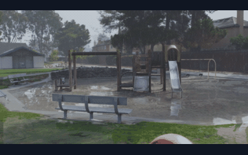</a><br><b>Playground</b></td>
    <td align="center" width="33%"><a href="media/rainy_gs/firewoods.mp4">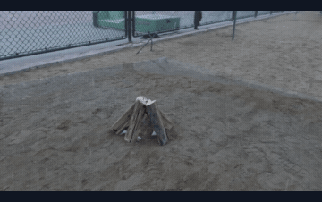</a><br><b>Firewoods</b></td>
    <td align="center" width="33%"><a href="media/rainy_gs/train.mp4">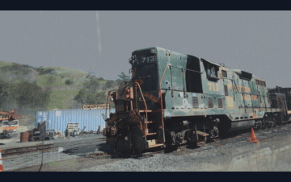</a><br><b>Train</b></td>
  </tr>
</table>

[**Code & run guide →**](rainy_gs/README.md)

<a id="gaussian-splashing"></a>

## Gaussian Splashing

[Gaussian Splashing](https://gaussiansplashing.github.io/) unifies particles for fluid and solid motion synthesis and Gaussian rendering.

<table>
  <tr>
    <td align="center" width="33%"><a href="media/gaussian_splashing/liquify.mp4">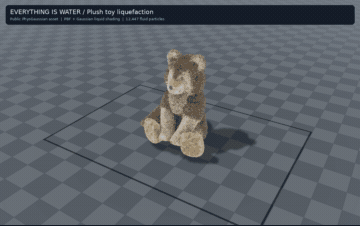</a><br><b>Liquefy</b></td>
    <td align="center" width="33%"><a href="media/gaussian_splashing/wave.mp4">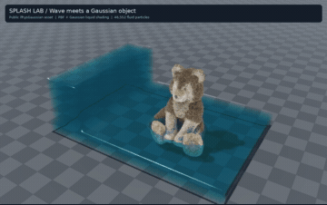</a><br><b>Wave</b></td>
    <td align="center" width="33%"><a href="media/gaussian_splashing/plunge.mp4">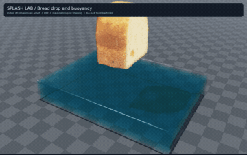</a><br><b>Plunge</b></td>
  </tr>
</table>

[**Code & run guide →**](gaussian_splashing/README.md)

<a id="enliveninggs"></a>

## EnliveningGS

[EnliveningGS](https://gapszju.github.io/EnliveningGS/) gives 3D Gaussian objects active locomotion through muscle-driven deformation and contact.

<table>
  <tr>
    <td align="center" width="33%"><a href="media/enlivening_gs/bread.mp4">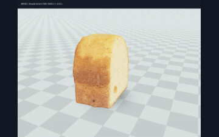</a><br><b>Hopping bread</b></td>
    <td align="center" width="33%"><a href="media/enlivening_gs/wolf.mp4">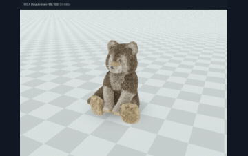</a><br><b>Turning wolf</b></td>
    <td align="center" width="33%"><a href="media/enlivening_gs/vasedeck.mp4">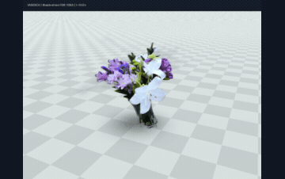</a><br><b>Dancing vase</b></td>
  </tr>
</table>

[**Code & run guide →**](enlivening_gs/README.md)

<a id="magnetic-mpm"></a>

## Magnetic MPM

[A Material Point Method for Nonlinearly Magnetized Materials](https://binwangbfa.github.io/publication/siga21_mpm/) couples nonlinear magnetic fields with deformable solids and viscous fluids.

<table>
  <tr>
    <td align="center" width="33%"><a href="media/magnetic_mpm/ferrofluid.mp4">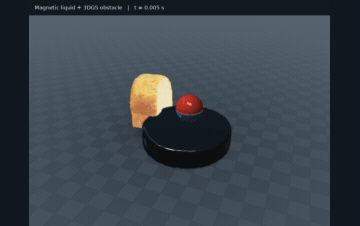</a><br><b>Ferrofluid</b></td>
    <td align="center" width="33%"><a href="media/magnetic_mpm/magnetic_bread.mp4">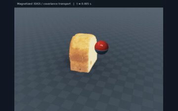</a><br><b>Magnetic bread</b></td>
    <td align="center" width="33%"><a href="media/magnetic_mpm/magnetic_wolf.mp4">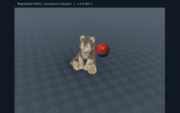</a><br><b>Magnetic wolf</b></td>
  </tr>
</table>

[**Code & run guide →**](magnetic_mpm/README.md)

<a id="snowygs"></a>

## SnowyGS

SnowyGS combines [A Material Point Method for Snow Simulation](https://alexey.stomakhin.com/research/snow.html) with Gaussian scenes for wind-driven snowfall and accumulated snow.

<table>
  <tr>
    <td align="center" width="33%"><a href="media/snowy_gs/playground.mp4">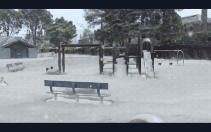</a><br><b>Playground</b></td>
    <td align="center" width="33%"><a href="media/snowy_gs/firewoods.mp4">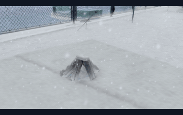</a><br><b>Firewoods</b></td>
    <td align="center" width="33%"><a href="media/snowy_gs/train.mp4">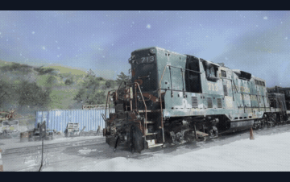</a><br><b>Train</b></td>
  </tr>
</table>

[**Code & run guide →**](snowy_gs/README.md)

<a id="diffwind"></a>

## DiffWind

[DiffWind](https://github.com/zju3dv/DiffWind) models wind-driven Gaussian object dynamics through differentiable fluid-solid coupling with LBM and MPM.

<table>
  <tr>
    <td align="center" valign="top" width="33%"><a href="https://github.com/zju3dv/DiffWind/blob/main/media/results/potted_plant_view0.mp4"></a><br><b>Potted Plant</b></td>
    <td align="center" valign="top" width="33%"><a href="https://github.com/zju3dv/DiffWind/blob/main/media/results/sweater_view0.mp4"></a><br><b>Sweater</b></td>
    <td align="center" valign="top" width="33%"><a href="https://github.com/zju3dv/DiffWind/blob/main/media/results/flag_view0.mp4"></a><br><b>Flag</b></td>
  </tr>
</table>

[**Code & run guide →**](https://github.com/zju3dv/DiffWind)

<a id="physskin"></a>

## PhysSkin

[PhysSkin](https://github.com/zju3dv/PhysSkin) learns continuous neural skinning fields for real-time, generalizable physics-based animation across diverse 3D shapes.

<p align="center">
  <a href="https://huggingface.co/papers/2610.26067?image-viewer=B81F15613A4EABA144DFC55E0D95B4EA498EE910">
    
  </a>
  <br>
  <a href="https://huggingface.co/papers/2610.26067?image-viewer=B81F15613A4EABA144DFC55E0D95B4EA498EE910"><b>▶ Watch the PhysSkin++ teaser</b></a>
</p>

[**Code & run guide →**](https://github.com/zju3dv/PhysSkin)

<a id="megas"></a>

## MeGAS

[MeGAS](https://zju3dv.github.io/MeGAS/) brings temperature fields and thermomechanical phase transitions to Gaussian scenes for melting and solidification.

<p align="center">
  <b>Kitchen</b><br>
  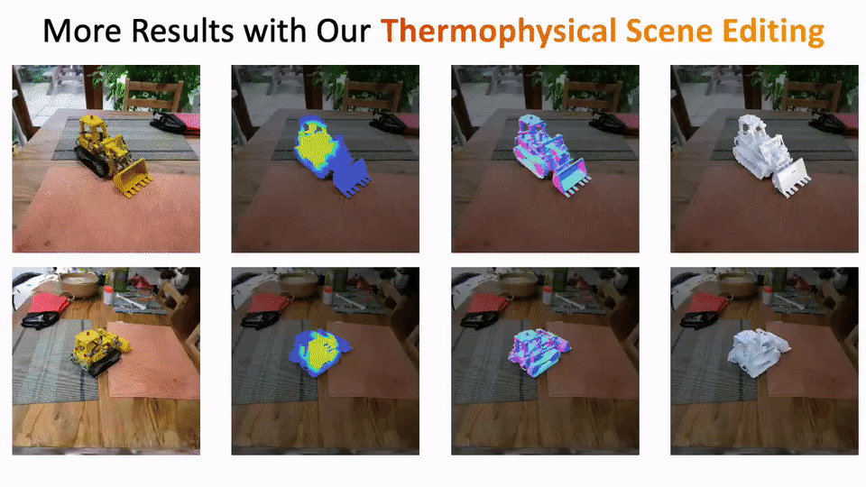
</p>

[**Code & run guide →**](https://github.com/zju3dv/MeGAS)

<a id="lavags"></a>

## LavaGS

LavaGS combines [Augmented MPM for Phase-Change and Varied Materials](https://www.cs.ucr.edu/~craigs/papers/2014-melting/paper.pdf) with Gaussian scenes for lava flow, crust formation, rock contact, and thermal emission.

<table>
  <tr>
    <td align="center" valign="top" width="33%"><a href="media/lava_gs/zohar.mp4">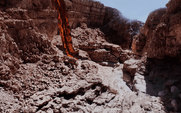</a><br><b>Zohar canyon</b></td>
    <td align="center" valign="top" width="33%"><a href="media/lava_gs/lands_end.mp4">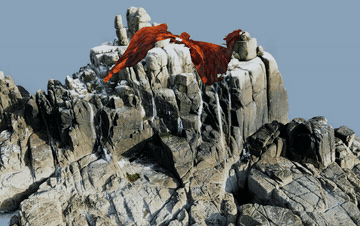</a><br><b>Land's End cliff</b></td>
    <td align="center" valign="top" width="33%"><a href="media/lava_gs/calico.mp4">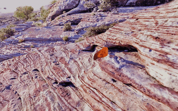</a><br><b>Calico</b></td>
  </tr>
</table>

[**Code & run guide →**](lava_gs/README.md)

<a id="water-sand"></a>

## Water + Sand

Water + Sand combines [Volume-Preserving LBM-MPM Coupling for Air-Water-Sand Mixtures](https://lwkobe.github.io/papers/XWYDL2026/) with Gaussian rendering for 3D sandcastle erosion, sedimentation, and dam overtopping.

<table>
  <tr>
    <td align="center" valign="top" width="33%"><a href="media/water_sand/breach.mp4">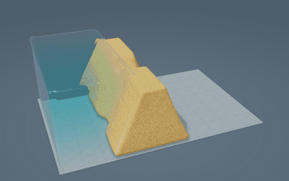</a><br><b>Sand dam</b></td>
    <td align="center" valign="top" width="33%"><a href="media/water_sand/sediment.mp4">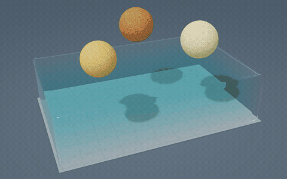</a><br><b>Sedimentation</b></td>
    <td align="center" valign="top" width="33%"><a href="media/water_sand/castle.mp4">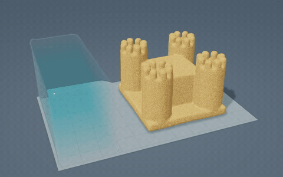</a><br><b>Sandcastle</b></td>
  </tr>
</table>

[**Code & run guide →**](water_sand/README.md)

<a id="plant-wilting"></a>

## Plant Wilting

[A Physically-inspired Approach to the Simulation of Plant Wilting](https://dl.acm.org/doi/10.1145/3610548.3618218) couples water transport and material softening to animate drying plants, rendered here with 3D Gaussians.

<table>
  <tr>
    <td align="center" valign="top" width="33%"><a href="media/plant_wilting/potted_plant.mp4">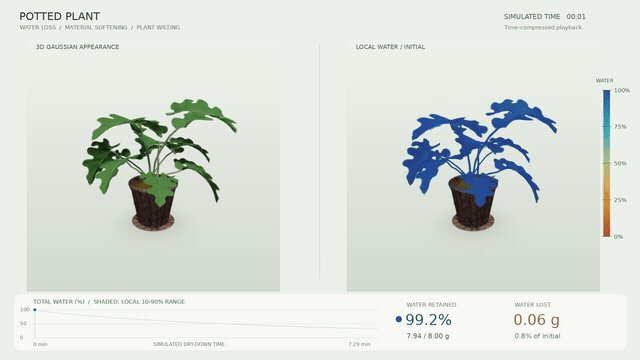</a><br><b>Potted Plant</b></td>
    <td align="center" valign="top" width="33%"><a href="media/plant_wilting/ficus.mp4">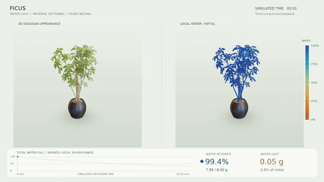</a><br><b>Ficus</b></td>
    <td align="center" valign="top" width="33%"><a href="media/plant_wilting/alocasia.mp4">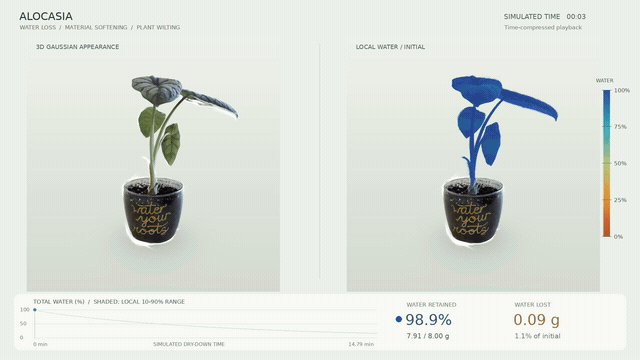</a><br><b>Alocasia</b></td>
  </tr>
</table>

[**Code & run guide →**](plant_wilting/README.md)

---

## Run a demo

See [installation](INSTALL.md) for the CUDA environment, then:

```bash
python -m physstudio fetch bread
python -m physstudio run enlivening bread --gpu 0
```

Use `--frames 12 --width 640` for a quick preview and `--output` for a custom
run directory. Use `--dry-run` to print the launcher's exact commands.
Pretrained models are downloaded separately; [asset links](ASSETS.md) and
[project credits](THIRD_PARTY.md) are collected in the repository.

<details>
<summary><b>Repository map</b></summary>

```text
rainy_gs/             Rain, shallow water, ripples, and reflections
gaussian_splashing/   Position-based fluids and Gaussian liquid rendering
enlivening_gs/        Muscle-driven FEM and Gaussian deformation
magnetic_mpm/        Nonlinear magnetic fields coupled to MLS-MPM
snowy_gs/             Elastoplastic snow, airborne flakes, and accumulation
lava_gs/              Thermoviscoplastic lava, rock contact, and thermal emission
water_sand/           Air–water LBM, granular MPM, and Gaussian grains
plant_wilting/        Water transport, Newton rods, and Gaussian plant motion
physstudio/           Shared launcher, paths, and download utilities
media/                Demo videos, animated previews, and an HTML gallery
```

</details>
